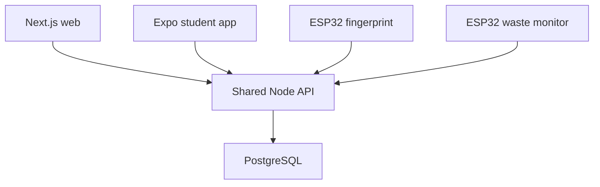

# MessMate architecture

One API owns all authentication, authorization, meal scheduling and database access. Next.js serves web pages and proxies /api to the API. Expo uses that API directly with an opaque bearer session stored in SecureStore. ESP32 devices use independently revocable tokens, never user sessions. No paid platform is required.

Development uses PGlite when PostgreSQL is absent. It runs actual PostgreSQL in WebAssembly with the same SQL migrations. Only a single API process may own a file-backed PGlite directory. Production requires PostgreSQL with a connection pool. Schema lives in packages/database; migrations are versioned and transactional.

Roles: STUDENT accesses only their own data. MESS_ADMIN manages mess operations. ADMIN also manages administrators, assumptions and audit logs. Every API checks role independently of navigation.

Meal windows use Asia/Kolkata, inclusive start and exclusive end. Preferences close at the stored cutoff. Device time cannot override server time. Attendance uniqueness is enforced in the database. Waste readings are cumulative snapshots with explicit tare sessions and a session high-water mark; repeated/lower readings add no waste. Emptying requires a tare, never an inferred negative increment.

Design: forest green, warm off-white surfaces, crisp borders, serif display headings with system sans body. Components follow shadcn composition with Radix accessible dialogs, CVA button variants and Tailwind utilities. Data tables scroll inside their cards. All data panels load from the API; seed data is explicit and fictional.

API contracts and database tables are documented in API.md and DATABASE.md. The public website and mobile app never connect to PostgreSQL directly.
